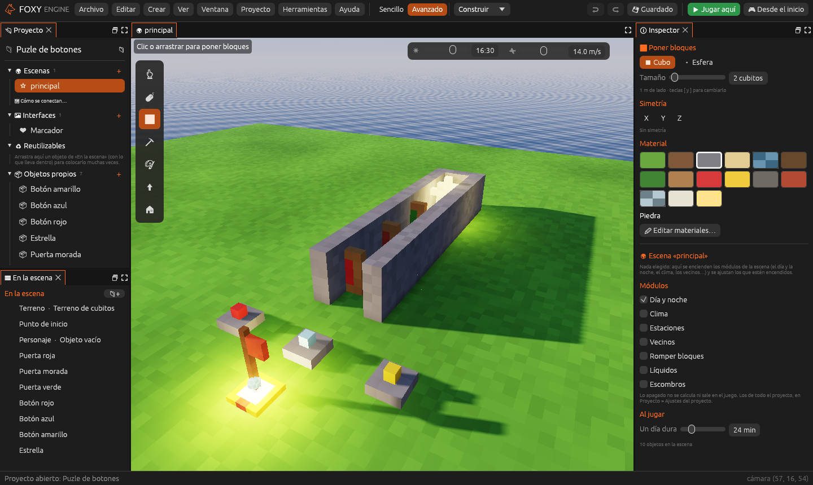

# Puzle

Un juego **de pensar**: hay que averiguar cómo abrir el camino antes de
correr por él. La plantilla es **Puzle de botones**: tres botones de colores
y tres puertas seguidas. Cada botón abre y cierra **más de una** puerta, así
que hay que pensar qué botones pulsar para que las tres queden abiertas a la
vez.

## 1. Crear el proyecto

1. En la pantalla de inicio, pulsa **Nuevo proyecto**.
2. En **¿Qué juego quieres hacer?**, dentro de *Puzle*, elige **Puzle de
   botones**.
3. Escribe un nombre y pulsa **Crear proyecto**.

## 2. Jugarlo

Pulsa **Jugar aquí** (<kbd>F5</kbd>). Pisa los botones (rojo, azul y
amarillo) y mira qué puertas se mueven. Cuando las tres estén abiertas,
recorre el pasillo y coge la estrella.

> <i class="fx fx-consejo"></i> **Pista.** Cada vez que pisas un botón, sus
> puertas cambian: las abiertas se cierran y las cerradas se abren. No
> sigas leyendo si quieres resolverlo tú.

## 3. Ver cómo está hecho

El truco está en las **[etiquetas](../guia/objetos-que-se-hablan.md#etiquetas)**.
Elige cada puerta y mira sus etiquetas en el Inspector:

| Puerta | Etiquetas | La mueven |
|---|---|---|
| **Puerta roja** | `rojo` | El botón rojo |
| **Puerta morada** | `rojo`, `azul` | Los botones rojo y azul |
| **Puerta verde** | `azul`, `amarillo` | Los botones azul y amarillo |

Cada botón lleva el comportamiento **Botón que activa a los de una
etiqueta**, con su color en `etiqueta`. Al pisarlo manda «activar» a todos
los objetos con esa etiqueta, y cada puerta, con **Puerta que se abre** y
`con_boton` marcado, se abre o se cierra al recibirlo.

La solución es pisar el **rojo** y el **amarillo**, una vez cada uno.

## 4. Cambiarlo

1. **Otro puzle.** Cambia las etiquetas de las puertas. Por ejemplo, pon
   `amarillo` también en la Puerta roja. ¿Cuál es ahora la solución?
2. **Una cuarta puerta.** Duplica la Puerta verde, llévala más adelante y
   dale la etiqueta `rojo`.
3. **Un cuarto botón.** Duplica un botón y cambia su `etiqueta` a `verde`.
   Ponle esa etiqueta a alguna puerta.
4. **Más difícil.** Añade a una puerta el comportamiento **Plataforma que
   se mueve**: tendrás que pasar en el momento justo.

## Seguir

- [Objetos que se hablan](../guia/objetos-que-se-hablan.md): etiquetas,
  eventos y mensajes entre objetos.
- [Comportamientos](../guia/comportamientos.md): cómo están hechos los
  botones y las puertas por dentro.
- [Nodos](../guia/nodos.md): haz tu propio botón que, por ejemplo, solo
  funcione si llevas una moneda.
