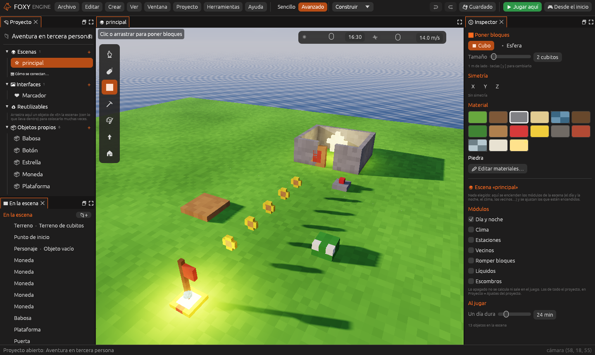

# Tercera persona

Un juego **3D con el personaje visto por detrás**: la cámara lo sigue
mientras anda, salta y recoge cosas. La plantilla es **Aventura en tercera
persona**, un recorrido corto con todo lo básico: monedas, un enemigo, una
plataforma, un botón, una puerta y una estrella al final.

## 1. Crear el proyecto

1. En la pantalla de inicio, pulsa **Nuevo proyecto**.
2. En **¿Qué juego quieres hacer?**, dentro de *3D en tercera persona*,
   elige **Aventura en tercera persona**.
3. Escribe un nombre y pulsa **Crear proyecto**.

## 2. Jugarlo

Pulsa **Jugar aquí** (<kbd>F5</kbd>). El personaje anda con <kbd>W</kbd>
<kbd>A</kbd> <kbd>S</kbd> <kbd>D</kbd>, salta con <kbd>Espacio</kbd> y la
cámara gira con el ratón. Sigue el camino de monedas, esquiva a la babosa,
pisa el botón para abrir la puerta del patio y coge la estrella. El
marcador cuenta las monedas y las estrellas.

## 3. Ver cómo está hecho

Elige cada objeto con un clic y mira sus **comportamientos** en el
Inspector. Todos son de los [ya hechos](../guia/comportamientos.md#los-comportamientos-ya-hechos):

| Objeto | Comportamientos | Qué hacen |
|---|---|---|
| **Moneda** | Recoger, Girar | Suma 1 a `monedas` al tocarla y da vueltas |
| **Babosa** | Patrullar, Hacer daño | Va y viene 6 m y quita 10 de vida al tocarte |
| **Plataforma** | Plataforma que se mueve | Sube 2 m y baja, cada 2 segundos |
| **Botón** | Botón que activa algo | Manda «activar» al objeto que se llama `Puerta` |
| **Puerta** | Puerta que se abre | Con `con_boton` marcado, solo la abre el botón |
| **Estrella** | Recoger, Flotar, Girar | Suma 1 a `estrellas` |

El **Personaje** tiene los componentes **Controlador de jugador** (tipo
*Tercera persona*), **Cámara** y **Animador**, que pone su animación de
andar, correr o saltar.

El guion del mundo solo saluda al empezar y te felicita cuando
`estrellas` llega a 1.

## 4. Cambiarlo

1. **Una babosa más rápida.** Elige la Babosa y sube su `velocidad` en el
   Inspector. Prueba.
2. **Una plataforma más alta.** Elige la Plataforma y cambia su `recorrido`
   a `(0, 4, 0)`. Ahora sube 4 m.
3. **Una puerta sin botón.** Elige la Puerta y desmarca `con_boton`: se
   abrirá sola al acercarte.
4. **Monedas que flotan.** Elige una moneda y pulsa **➕ Comportamiento →
   Ya hechos → Flotar**.
5. **Otro enemigo.** Duplica la Babosa
   (<kbd>Cmd</kbd>/<kbd>Ctrl</kbd>+<kbd>D</kbd>), muévela y cámbiale
   **Patrullar** por **Seguir al jugador**: ahora te persigue.
6. **Tu propio objeto.** En el panel Proyecto, abre **Objetos propios →
   Moneda** y dibújala de otro color. Todas las monedas cambian.

> <i class="fx fx-consejo"></i> **Consejo.** Los valores de un
> comportamiento son de cada objeto: dos babosas pueden ir a velocidades
> distintas aunque usen el mismo **Patrullar**.

## Seguir

- [Tutorial: un enemigo que persigue](../guia/tutorial-enemigo.md): vida,
  barra de vida y pantalla de derrota.
- [Animación](../guia/animacion.md) y
  [Personajes por piezas](../guia/personajes-piezas.md).
- [Modelos 3D](../guia/modelos-3d.md): cambia el personaje por un modelo
  tuyo.
