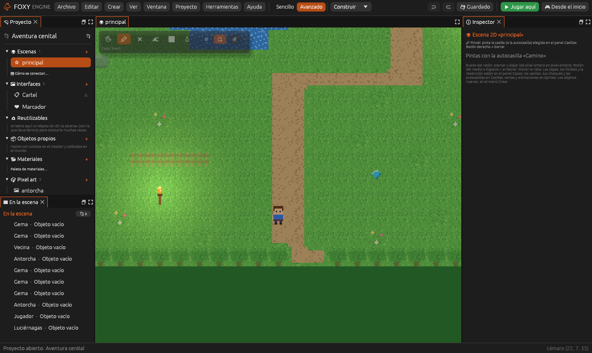

# Vista desde arriba

Un juego de **explorar un mapa visto desde arriba**, como las aventuras
clásicas: andar por el prado, hablar con la gente y buscar cosas. La
plantilla es **Aventura cenital**.

## 1. Crear el proyecto

1. En la pantalla de inicio, pulsa **Nuevo proyecto**.
2. En **¿Qué juego quieres hacer?**, dentro de *Vista desde arriba*, elige
   **Aventura cenital**.
3. Escribe un nombre y pulsa **Crear proyecto**.

## 2. Jugarlo

Pulsa **Jugar aquí** (<kbd>F5</kbd>). El héroe anda en las cuatro
direcciones con <kbd>W</kbd> <kbd>A</kbd> <kbd>S</kbd> <kbd>D</kbd>. Acércate
a la **Vecina**: te pide que busques cuatro gemas que se le han caído por el
prado. El marcador cuenta las que llevas.

## 3. Ver cómo está hecho

- Cada **Gema** tiene el componente **Recogible**, que suma 1 al valor
  `gemas`, y el comportamiento ya hecho **Flotar**.
- La **Vecina** tiene una **Zona**: al entrar el jugador, abre la interfaz
  **Cartel** con su mensaje.
- El agua del lago y los árboles son casillas que **chocan**: el héroe no
  puede pasar por ellas. Ver [Mapas de casillas](../guia/casillas.md).
- Las **Antorchas** son sprites con una animación que se repite.

## 4. Cambiarlo

1. **Otro mensaje.** Abre la interfaz **Cartel** del panel Proyecto y
   cambia lo que dice la vecina.
2. **Más gemas.** Duplica una gema
   (<kbd>Cmd</kbd>/<kbd>Ctrl</kbd>+<kbd>D</kbd>) y llévala a un rincón
   escondido.
3. **Una gema que gira.** Elige una gema y añádele **➕ Comportamiento → Ya
   hechos → Girar**.
4. **Alguien que te sigue.** Duplica a la vecina, quítale la Zona en **Más
   ajustes** y dale **Seguir al jugador**.
5. **Un camino nuevo.** En el panel [Casillas](../interfaz/casillas.md),
   elige el camino y píntalo hasta el lago.

## Seguir

- [Juegos 2D](../guia/juegos-2d.md) y [Sprites](../guia/sprites.md).
- [Interfaces](../guia/interfaces.md): carteles, marcadores y menús.
- [Objetos que se hablan](../guia/objetos-que-se-hablan.md): que la vecina
  diga otra cosa cuando ya tienes las gemas.
